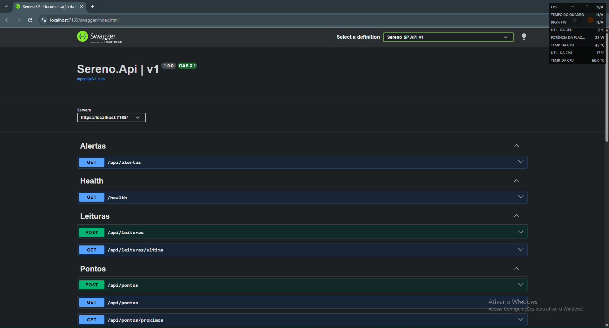
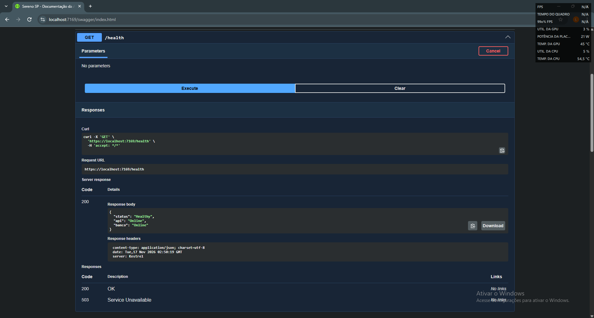
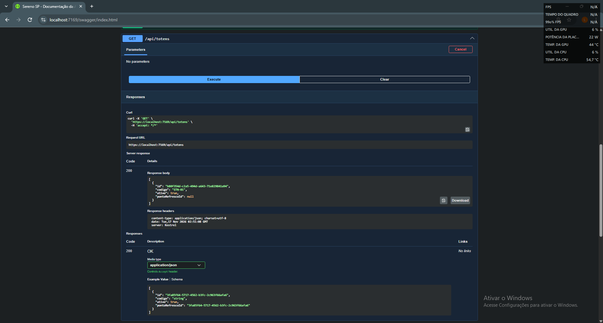
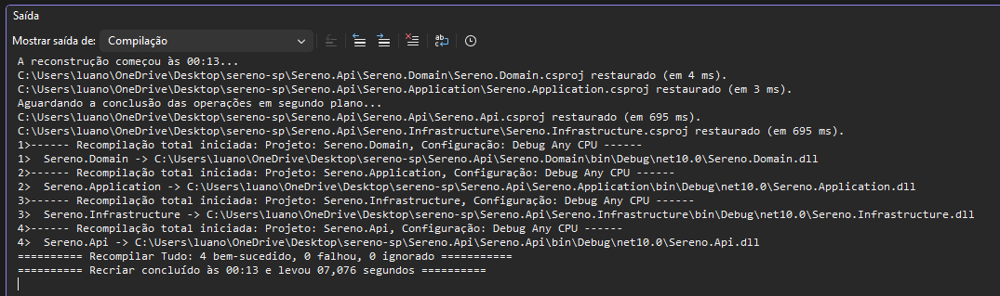
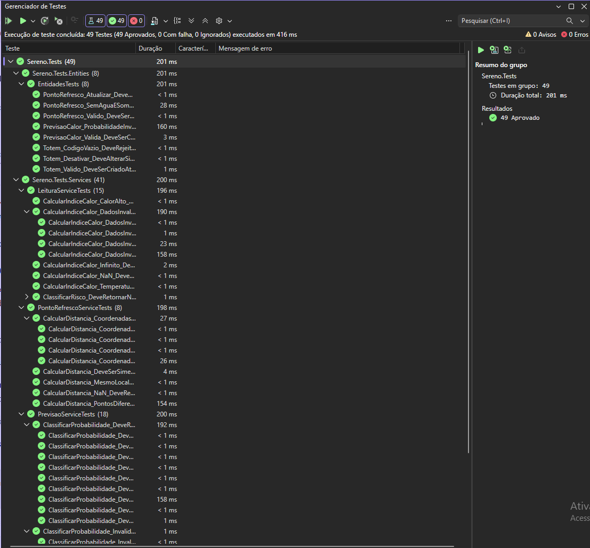
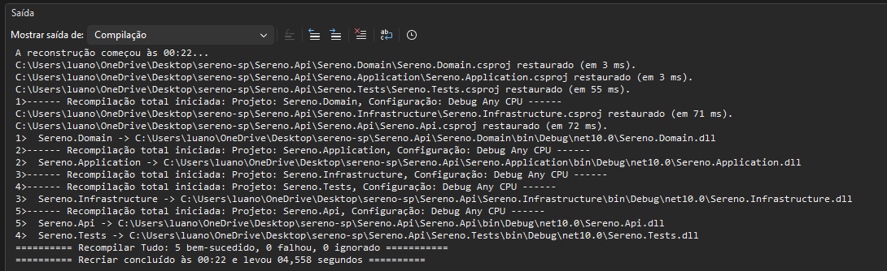

# Sereno SP — SOA e Web Services

**Global Solution CitizenTech 2026 · FIAP**  
**Disciplina:** Arquitetura Orientada a Serviços (SOA) e Web Services

## Integrantes

| Integrante | RM |
|---|---|
| Luan Orlandelli Ramos | 554747 |
| Arthur Bobadilla Franchi | 55056 |
| Jorge Luiz Silva Santos | 554418 |

## O problema: o calor urbano e a dificuldade de se proteger

Em São Paulo, episódios de calor intenso tornam atividades cotidianas — caminhar até um serviço, trabalhar ao ar livre ou permanecer em espaços públicos — mais desgastantes e potencialmente perigosas. O risco não depende apenas da temperatura registrada: a umidade do ar também influencia a sensação térmica e o estresse provocado pelo calor. Em uma cidade extensa e com condições ambientais diferentes entre bairros, uma informação meteorológica geral nem sempre ajuda alguém a decidir o que fazer no lugar onde está.

O problema se torna especialmente relevante para **pessoas idosas, sobretudo as que vivem sozinhas ou passam parte do dia fora de casa, e trabalhadores expostos ao sol**, como entregadores, ambulantes e profissionais de limpeza urbana. Para esses públicos, saber que o dia estará quente é insuficiente. É necessário responder a perguntas práticas: **o calor neste local já representa perigo? A situação pode piorar amanhã? Onde há água ou sombra por perto?**

A proposta do Sereno SP parte dessa lacuna entre a informação sobre o clima e a possibilidade de agir. Seu recorte inicial é a **região de Santana, na zona norte de São Paulo**, com a intenção de combinar dados ambientais locais, alertas compreensíveis e indicação de lugares de apoio. O objetivo não é substituir orientações de saúde ou serviços meteorológicos oficiais, mas **transformar informações sobre calor em orientações acessíveis para reduzir a exposição ao risco**.

## A solução proposta: Sereno SP

O **Sereno SP** é uma proposta de *CitizenTech* voltada à proteção das pessoas em situações de calor urbano intenso. A ideia é oferecer uma jornada simples: **entender o risco atual, antecipar a condição do dia seguinte e encontrar um local próximo para se refrescar**. Em vez de apresentar apenas números de temperatura, a solução organiza os dados em informações que podem apoiar decisões do cotidiano.

A proposta reúne três frentes complementares:

1. **Monitoramento local:** totens/sensores registram temperatura e umidade. A partir das leituras, o sistema calcula o índice de calor, classifica o nível de risco e pode gerar alertas relacionados à situação observada.
2. **Antecipação do risco:** previsões de calor para datas específicas são recebidas e armazenadas, incluindo probabilidade, classificação e mensagem de orientação. A integração com um modelo de aprendizado de máquina faz parte da proposta interdisciplinar; **esta entrega de SOA implementa a API que recebe e disponibiliza as previsões, não o treinamento do modelo**.
3. **Orientação para proteção:** pontos de refresco são cadastrados com localização e informações como disponibilidade de água e sombra. A API permite consultar locais próximos, ordenados por distância, para que outras interfaces possam orientar o cidadão até uma opção de apoio.

### Exemplo de uso

Imagine uma pessoa idosa que precisa sair de casa em um dia de muito calor. Antes de sair, ela pode consultar uma previsão que sinalize maior risco para o dia seguinte. Ao circular por Santana, uma leitura de sensor pode indicar calor perigoso e originar um alerta. Com base em sua localização, ela pode receber uma lista de pontos de refresco próximos — por exemplo, espaços públicos cadastrados com sombra ou acesso a água. O foco é permitir que a informação resulte em uma ação concreta: **reduzir a exposição ao sol, procurar um ambiente mais protegido e planejar melhor os deslocamentos**.

### Papel desta entrega de SOA e Web Services

Esta entrega concentra-se no **backend de integração** do Sereno SP. A API REST, desenvolvida em C#/.NET, é responsável por:

- Gerenciar o cadastro e a consulta dos totens de monitoramento;
- Receber leituras ambientais, calcular e classificar o índice de calor e registrar alertas;
- Cadastrar e consultar pontos de refresco, incluindo busca geográfica por proximidade;
- Receber, persistir e consultar previsões de calor;
- Disponibilizar os dados em endpoints HTTP documentados por OpenAPI/Swagger;
- Persistir as informações no PostgreSQL com Entity Framework Core e migrações versionadas;
- Verificar a disponibilidade da API e do banco pelo endpoint `/health`.

A arquitetura é organizada em camadas (`Domain`, `Application`, `Infrastructure` e `Api`) para separar as regras de negócio da exposição dos serviços e do acesso aos dados. O projeto inclui testes automatizados xUnit para validar comportamentos centrais. **Aplicativo móvel, sensores físicos/simulados e treinamento do modelo de ML pertencem a outras frentes da proposta CitizenTech; não são apresentados aqui como funcionalidades implementadas por esta API.**

### Impacto esperado

A contribuição esperada é facilitar o acesso a informações locais e antecipadas sobre calor, aproximando alertas ambientais de decisões úteis para a população. Ao oferecer uma API organizada e documentada, o Sereno SP também cria uma base de integração para aplicativos, dispositivos e serviços que ajudem a construir uma cidade mais preparada para eventos de calor extremo. **Trata-se do impacto pretendido pela solução, não de um resultado de campo já medido.**

## Tecnologias

- C# e **.NET 10 / ASP.NET Core Web API**
- **PostgreSQL** e **Entity Framework Core** (provedor Npgsql)
- **OpenAPI** e **Swagger UI**
- **xUnit** para testes automatizados
- Git e GitHub

## Organização da solução

```text
Sereno.Api.slnx
Sereno.Api/              # Controllers, configuração e endpoints
Sereno.Application/      # Serviços de aplicação, DTOs e interfaces
Sereno.Domain/           # Entidades e enumerações
Sereno.Infrastructure/   # DbContext, repositórios e migrações EF Core
Sereno.Tests/            # Testes automatizados xUnit
evidencias/soa/           # Evidências de execução
sereno-migrations.sql    # Script SQL de migrações (complementar)
```

A separação em camadas permite manter as regras de domínio isoladas da API e da persistência. O `Program.cs` registra os repositórios e serviços por injeção de dependência.

## Funcionalidades e endpoints

| Método | Rota | Finalidade |
|---|---|---|
| GET | `/health` | Verificar disponibilidade da API e conexão com o banco |
| POST | `/api/totens` | Cadastrar totem |
| GET | `/api/totens` | Listar totens |
| GET | `/api/totens/{id}` | Consultar totem |
| PUT | `/api/totens/{id}` | Atualizar totem |
| DELETE | `/api/totens/{id}` | Excluir totem |
| POST | `/api/leituras` | Registrar leitura de sensor |
| GET | `/api/leituras/ultima?totemCodigo=STN-01` | Consultar última leitura de um totem |
| GET | `/api/alertas` | Listar alertas |
| POST | `/api/pontos` | Cadastrar ponto de refresco |
| GET | `/api/pontos` | Consultar pontos de refresco |
| GET | `/api/pontos/proximos?lat=-23.505&lon=-46.625&limite=3` | Encontrar pontos mais próximos |
| GET | `/api/pontos/{id}` | Consultar ponto |
| PUT | `/api/pontos/{id}` | Atualizar ponto |
| DELETE | `/api/pontos/{id}` | Excluir ponto |
| POST | `/api/previsoes` | Registrar previsão de calor |
| GET | `/api/previsoes/amanha` | Consultar previsão do dia seguinte |
| GET | `/api/previsoes/data/2026-11-14` | Consultar previsão por data |

> A documentação OpenAPI fornece os parâmetros e formatos de entrada e saída dos endpoints; alguns endpoints exigem dados previamente cadastrados.

## Requisitos para executar localmente

1. **SDK do .NET 10** instalado.
2. **PostgreSQL** em execução.
3. Uma base de dados para a aplicação e um usuário PostgreSQL com as permissões necessárias para as migrações.
4. Visual Studio ou terminal com a CLI `dotnet`.

### 1. Obter o código e restaurar dependências

```powershell
git clone https://github.com/LuanOrlandelli/sereno-sp-soa.git
cd sereno-sp-soa
dotnet restore Sereno.Api.slnx
```

### 2. Configurar a conexão com o banco

O projeto lê a string de conexão chamada `DefaultConnection`. **Não coloque credenciais no repositório.** Para desenvolvimento local, use User Secrets no projeto web:

```powershell
cd Sereno.Api
dotnet user-secrets set "ConnectionStrings:DefaultConnection" "Host=localhost;Port=5432;Database=sereno_sp;Username=SEU_USUARIO;Password=SUA_SENHA"
cd ..
```

Substitua `SEU_USUARIO` e `SUA_SENHA` pelos dados locais do seu PostgreSQL. O banco `sereno_sp` deverá existir e o usuário deverá ter as permissões adequadas.

### 3. Aplicar as migrações

No Visual Studio, abra **Ferramentas → Gerenciador de Pacotes NuGet → Console do Gerenciador de Pacotes** e execute:

```powershell
Update-Database -Project Sereno.Infrastructure -StartupProject Sereno.Api
```

As migrações versionadas estão em `Sereno.Infrastructure/Data/Migrations/`:

- `InitialCreate`
- `AddAlertas`
- `AddPrevisoes`

### 4. Executar a API

Na raiz da solução:

```powershell
dotnet run --project Sereno.Api --launch-profile https
```

A porta exata pode variar de acordo com o perfil de execução. No ambiente de desenvolvimento utilizado no projeto, a API foi testada em `https://localhost:7169`.

- **Swagger UI:** `https://localhost:7169/swagger`
- **OpenAPI JSON:** `https://localhost:7169/openapi/v1.json`
- **Health check:** `https://localhost:7169/health`

O Swagger e a documentação OpenAPI estão habilitados no ambiente `Development`.

## Testes automatizados

Na raiz da solução:

```powershell
dotnet test Sereno.Api.slnx
```

Na execução documentada para o desenvolvimento, **49 testes xUnit foram aprovados, com 0 falhas**. O comando acima permite reproduzir a execução no ambiente local.

## Critérios de avaliação de SOA

| Critério | Implementação / evidência |
|---|---|
| Estruturação do domínio (3,0) | `Sereno.Domain/Entities/`, `Sereno.Domain/Enums/` e serviços em `Sereno.Application/` |
| Conexão com banco (3,0) | `Sereno.Infrastructure/Data/SerenoDbContext.cs`, repositórios e registro do Npgsql no `Program.cs` |
| Migrações (1,5) | `Sereno.Infrastructure/Data/Migrations/` e `sereno-migrations.sql` |
| Documentação automática (1,5) | `/swagger` e `/openapi/v1.json` em ambiente de desenvolvimento |
| Testes automatizados (1,0) | `Sereno.Tests/` e evidência da execução xUnit |

## Evidências de execução — SOA e Web Services

As seis capturas abaixo estão na pasta `evidencias/soa/` e documentam a API, a persistência, a documentação automática e a execução dos testes. As imagens são exibidas diretamente no GitHub por meio de caminhos relativos, desde que a pasta `evidencias/soa/` seja publicada junto com este README.

### 1. Documentação automática dos endpoints — Swagger



A interface Swagger apresenta os endpoints REST disponibilizados pela aplicação e permite explorar suas operações.

### 2. Health check — API e banco disponíveis



O endpoint `/health` comprova a disponibilidade da API e a verificação de comunicação com o banco de dados no momento da execução.

### 3. Consulta REST de totens — HTTP 200



A operação `GET /api/totens` demonstra a exposição e a resposta de um recurso da API REST.

### 4. Compilação da solução



Registro do processo de compilação da solução no Visual Studio.

### 5. Testes automatizados — xUnit



A execução registrada apresentou **49 testes aprovados e 0 falhas**, evidenciando a validação automatizada das regras implementadas.

### 6. Compilação com o projeto de testes



Registro complementar da compilação da solução, incluindo o projeto `Sereno.Tests`.

> **Observação:** estas imagens são evidências da disciplina **SOA e Web Services**. A entrega de C# e a de Operating Systems terão seus próprios repositórios e documentação.

## Observações de segurança e ambiente

- Não publique senhas, `secrets.json`, arquivos `.env` reais, pastas `bin/`, `obj/`, `.vs/` ou artefatos de publicação.
- O ambiente de desenvolvimento local é demonstrativo. Para exposição pública, são necessários controles adicionais, como autenticação, TLS, validação e políticas de acesso.
- A infraestrutura Linux e os scripts de Operating Systems fazem parte de **outra entrega acadêmica**, em repositório separado.
